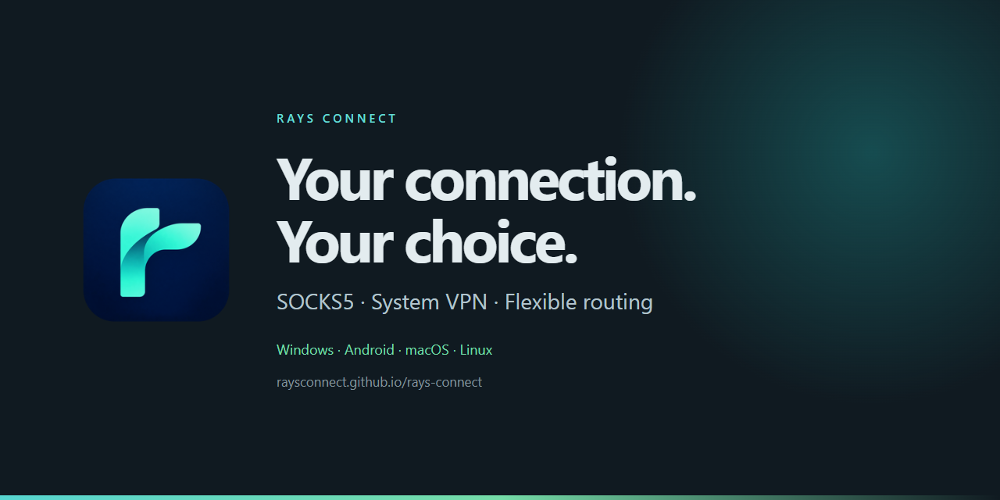

<p align="center">
  <a href="https://raysconnect.github.io/">
    
  </a>
</p>

<p align="center">
  <strong>SOCKS5 and system VPN clients with flexible routing.</strong><br>
  <a href="https://raysconnect.github.io/">Official website</a> ·
  <a href="https://github.com/RaysConnect/rays-connect/releases/tag/v1.1.0">Latest release</a> ·
  <a href="https://github.com/RaysConnect/rays-connect/releases/tag/v0.2.0">Earlier downloads</a> ·
  <a href="https://github.com/RaysConnect/rays-connect/issues">Report an issue</a>
</p>

Rays Connect connects your device to a Rays server through a profile supplied by
your administrator. Choose a local SOCKS5 proxy or a system VPN, use automatic
transport selection, and control which destinations connect directly.

This is the official **download and release repository**. Downloads do not include
a server profile, administrator credentials or a hosted VPN subscription.

## Downloads

| Platform | Version | Package | Requirements |
| --- | --- | --- | --- |
| Windows | **1.1.0** | [EXE](https://github.com/RaysConnect/rays-connect/releases/download/v1.1.0/rays-connect-windows-x64-setup.exe) · [MSI](https://github.com/RaysConnect/rays-connect/releases/download/v1.1.0/rays-connect-windows-x64.msi) | Windows 10/11 x64, Edge WebView2 |
| Android | **1.1.0** | [ARM64 APK](https://github.com/RaysConnect/rays-connect/releases/download/v1.1.0/rays-connect-android-arm64.apk) | Android 7.0+, ARM64 |
| macOS | 0.2.0 | [Apple Silicon DMG](https://github.com/RaysConnect/rays-connect/releases/download/v0.2.0/rays-connect-macos-arm64.dmg) | Apple Silicon / ARM64 |
| Linux | 0.2.0 | [AMD64 DEB](https://github.com/RaysConnect/rays-connect/releases/download/v0.2.0/rays-connect-linux-amd64.deb) · [ARM64 DEB](https://github.com/RaysConnect/rays-connect/releases/download/v0.2.0/rays-connect-linux-arm64.deb) | Debian-based distribution, glibc 2.39+; see release notes |

Windows EXE installs for the current user; MSI is intended for machine-wide
deployment. Choose one format. Windows installers are not Authenticode-signed.
The macOS 0.2.0 package is ad-hoc signed and is not Apple notarized.

**Android 0.2.0 → 1.1.0:** the public APK uses a new permanent signing key.
Save your shareable profile before uninstalling 0.2.0, then install 1.1.0 and
import it again. Uninstalling removes app settings and saved credentials.
For private profiles, ask your administrator for a replacement because the app
disables their export, sharing and copying. Keep the new installation for future
updates signed with the same key.

**Android 1.1.0 refresh:** this update retains the public 1.1.0 signing key and can be installed over the earlier public 1.1.0 APK without uninstalling.

## Get connected

1. Install the package for your device from the official links above.
2. Import your administrator's profile using a file, clipboard or QR code where supported.
3. Leave the transport on **Auto** to select an available endpoint, including
   configured Worker transports. Available choices depend on your profile.
4. Choose **SOCKS proxy** or **System VPN**, press Start and wait for Ready.
   SOCKS applications must use the displayed local proxy address, normally
   `127.0.0.1:1080`. VPN mode requires Android VPN consent or Windows administrator
   approval for the VPN helper.

5. On Android, use **Settings → Add Quick Settings tile**, then accept Android's
   tile prompt. Allow notifications to see connection status and the **Disconnect**
   action. The tile can start or stop the saved connection.

## Client features

- **Android quick controls:** a Quick Settings tile and a notification Disconnect
  action. The connection runs in a separate foreground service process and
  continues when the app window is dismissed. Android force-stop still stops it.
- **Two connection modes:** local SOCKS5 and system VPN integration.
- **Automatic transport selection:** qualifying endpoints and warm alternatives
  help new connections recover when a carrier stalls. Manual selection pins one
  endpoint and disables automatic fallback.
- **Direct routing:** domain, suffix, IP and CIDR rules on current Windows and
  Android clients. Direct destinations bypass the Rays tunnel. Reconnect after
  changing routing policy. Android also supports application routing policies.
- **Profile tools:** QR, clipboard and file import, with sharing controls for private profiles.
- **Device-aware interface:** bottom navigation on mobile, settings, themed
  scrollbars and dropdowns constrained to the visible screen.
- **Optional administration:** management is available when configured; your
  administrator manages profiles, quotas and server infrastructure.

## Verification and performance

Windows and Android **1.1.0** passed bounded live SOCKS and system VPN checks.
The Android release payload was tested on a physical Xiaomi phone, including
DNS, exact upload integrity, bulk downloads and concurrent requests. VPN checks
ran from a separate application UID. CPU, memory, thread count and temperature
were sampled during transfers and idle periods, including the isolated WebView
renderer. Background UI status polling pauses while the native VPN monitor continues.

The 16 October Android refresh passed 29/29 VPN checks with its UI closed and
17/17 SOCKS checks on the physical phone. The connection survived dismissing
the app from recent apps. A 45-second sample with only the connection process
running measured about 23–24 MiB PSS. Initial network retries were needed; these
results are bounded connectivity and lifecycle checks.

These checks do not establish day-long stability, battery life, streaming quality
or throughput guarantees. Performance depends on the device, access network,
transport and server. Existing TCP sessions cannot migrate between servers.
For 0.2.0, SOCKS was verified on macOS ARM64, Android ARM64 and Linux AMD64;
Linux ARM64 was build-only, and VPN testing was skipped. See the
[release notes](https://github.com/RaysConnect/rays-connect/releases) for exact scope.

## Integrity and support

Compare your package with `SHA256SUMS.txt` from the **same release** before
installation. Releases include third-party notices and signing information.
For example, in PowerShell:

```powershell
Get-FileHash .\rays-connect-android-arm64.apk -Algorithm SHA256
```

If Android stops the VPN after clearing recent apps or running a vendor cleaner,
open Rays again and check restrictions on background VPN services. Report
reproducible problems through [GitHub Issues](https://github.com/RaysConnect/rays-connect/issues)
with the app version, OS, connection mode and a redacted error. Never post profiles,
tokens, private keys or administrator passwords.

This repository contains the website and release artifacts. The application source
tree is not hosted here; GitHub's generated source archives contain the website.
Older releases remain available alongside current Windows and Android packages.
